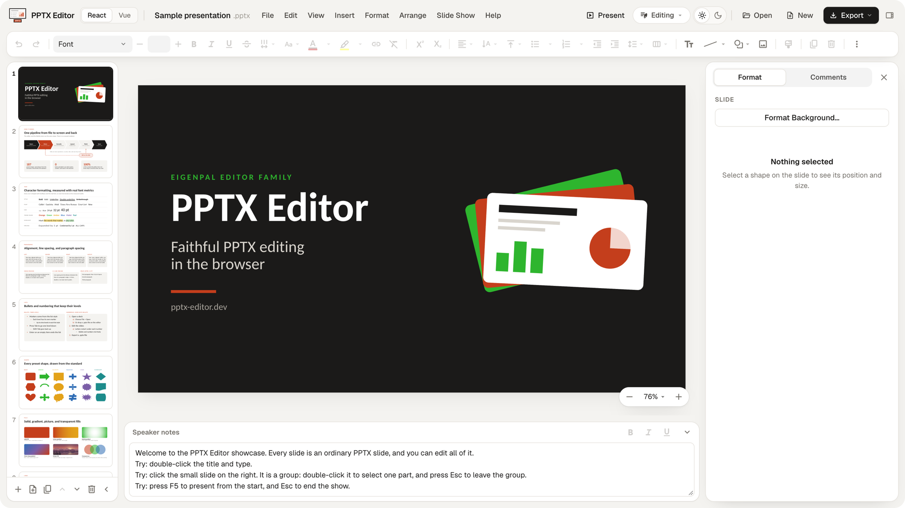

<p align="center">
  <a href="https://pptx-editor.dev/">
    <picture>
      <source media="(prefers-color-scheme: dark)" srcset="./.github/assets/readme-logo-dark.svg" />
      <source media="(prefers-color-scheme: light)" srcset="./.github/assets/readme-logo-light.svg" />
      
    </picture>
  </a>
</p>

<p align="center">
  <a href="https://www.npmjs.com/package/@pptx-editor.dev/core"></a>
  <a href="https://www.npmjs.com/package/@pptx-editor.dev/core"></a>
  <a href="https://github.com/eigenpal/pptx-editor/blob/main/LICENSE"></a>
  <a href="https://latest.pptx-editor.dev/"></a>
</p>

**PPTX Editor** is a WYSIWYG editor and headless rendering engine for `.pptx` presentations. Use it to edit, render, automate, and export slides on the client or the server. It uses the ECMA-376 (Office Open XML) format. Licensed packages add real-time collaboration, comments, and PDF export. It is part of the EigenPal editor family, with [DOCX Editor](https://docx-editor.dev).

[Live demo](https://latest.pptx-editor.dev/) | [Documentation](docs/site/content/index.mdx) | [Editor API](docs/site/content/editor-api/index.mdx) | [PPTX fidelity](docs/site/content/pptx-fidelity.mdx)

## Quick start

Install the adapter for your framework and its peers:

```bash
npm install @pptx-editor.dev/react @pptx-editor.dev/core   # React
npm install @pptx-editor.dev/vue @pptx-editor.dev/core     # Vue
```

See the [React](#react) or [Vue](#vue) quick start.

<p align="center">
  <a href="https://latest.pptx-editor.dev/"></a>
</p>

## Features

| Feature | Description |
| --- | --- |
| [Editor API](docs/site/content/editor-api/index.mdx) | Automate presentations in a browser or on a server with a supported subset of the Office.js presentation API. |
| [Slide editing](docs/site/data/pptx-features.ts) | Edit text, shapes, pictures, tables, and slides, with undo and redo. |
| [Faithful rendering](docs/site/content/pptx-fidelity.mdx) | Render themes, layouts, geometry, fills, and text layout by the ECMA-376 standard. |
| [Save and reopen](docs/site/data/pptx-features.ts) | Keep untouched content, unknown markup, and media when you save. |
| [Custom UI](docs/site/content/customization/index.mdx) | Replace or hide toolbar, ribbon, menu, and dialog controls, or build your own. |
| [Light and dark themes](docs/site/content/customization/appearance.mdx) | Match the editor chrome to your app with one set of tokens. |
| [React and Vue](#react) | Use either adapter with the same engine and styles. |
| [Fonts](packages/core/README.md#fonts) | Use embedded fonts, metric-compatible substitutes, or your own fonts. |
| [Review and collaboration](docs/site/content/pro/index.mdx) | Comment on slides and edit together in real time. |
| [PDF export](docs/site/content/export/pdf/index.mdx) | Convert presentations to PDF on Node.js. |

## Packages

| Package | Description | Docs |
| --- | --- | --- |
| [`@pptx-editor.dev/react`](https://www.npmjs.com/package/@pptx-editor.dev/react) | React editor components and hooks. | [React adapter](docs/site/content/react/index.mdx) |
| [`@pptx-editor.dev/vue`](https://www.npmjs.com/package/@pptx-editor.dev/vue) | Vue 3 editor components and composables. | [Vue adapter](docs/site/content/vue/index.mdx) |
| [`@pptx-editor.dev/core`](https://www.npmjs.com/package/@pptx-editor.dev/core) | The engine: parse, layout, paint, edit, and save. | [Core engine](docs/site/content/core/index.mdx) |
| [`@pptx-editor.dev/i18n`](https://www.npmjs.com/package/@pptx-editor.dev/i18n) | Interface strings. | [Language](docs/site/content/customization/language.mdx) |
| [`@pptx-editor.dev/pro`](https://www.npmjs.com/package/@pptx-editor.dev/pro) | Comments, drawing, and real-time collaboration modules, and the comments pane for React and Vue. | [Pro modules](docs/site/content/pro/index.mdx) |
| [`@pptx-editor.dev/editor-api`](https://www.npmjs.com/package/@pptx-editor.dev/editor-api) | A supported subset of the Office.js presentation API for browser and server editing. | [Presentation automation](docs/site/content/editor-api/index.mdx) |
| [`@pptx-editor.dev/pptx-to-pdf`](https://www.npmjs.com/package/@pptx-editor.dev/pptx-to-pdf) | Convert PPTX to PDF on Node.js. | [PDF export](docs/site/content/export/pdf/index.mdx) |

`@pptx-editor.dev/editor-api`, `@pptx-editor.dev/pro`, and `@pptx-editor.dev/pptx-to-pdf` use the EigenPal Pro License. See the license terms for [editor-api](packages/editor-api/LICENSE.md), [pro](packages/pro/LICENSE.md), and [pptx-to-pdf](packages/pptx-to-pdf/LICENSE.md).

## React

Pass the presentation bytes to the editor and give its container a height:

```tsx
import { PptxEditor } from '@pptx-editor.dev/react';
import '@pptx-editor.dev/react/styles.css';

export function App({ deck }: { deck: Uint8Array }) {
  return (
    <div style={{ height: '100vh' }}>
      <PptxEditor document={deck} />
    </div>
  );
}
```

For Next.js, load the editor with `dynamic(..., { ssr: false })`. See [`examples/nextjs`](examples/nextjs).

## Vue

Pass the same presentation bytes through the Vue adapter:

```vue
<script setup lang="ts">
import { PptxEditor } from '@pptx-editor.dev/vue';
import '@pptx-editor.dev/core/styles/editor.css';

defineProps<{ deck: Uint8Array }>();
</script>

<template>
  <div style="height: 100vh">
    <PptxEditor :document="deck" />
  </div>
</template>
```

## Documentation

- [Introduction](docs/site/content/index.mdx) and [quickstart](docs/site/content/quickstart.mdx): install the editor, open a deck, and save it.
- [Installation](docs/site/content/installation.mdx): packages, peer dependencies, styles, and bundlers.
- [Customization](docs/site/content/customization/index.mdx): appearance, layout, toolbar, ribbon, menus, dialogs, and fonts.
- [Tables](docs/site/content/guides/tables.mdx): insert and edit tables with editor commands.
- [Editor API](docs/site/content/editor-api/index.mdx): edit slides, shapes, text, and tables from code on a server or in an open editor.
- [PPTX fidelity](docs/site/content/pptx-fidelity.mdx): what you can edit, display, and save, and the known approximations.

For complete workflows, see [loading and saving](docs/site/content/guides/loading-and-saving.mdx), [collaboration](docs/site/content/pro/collaboration.mdx), and [PDF export](docs/site/content/export/pdf/index.mdx). The [`react`](packages/react/README.md) and [`vue`](packages/vue/README.md) READMEs list every part.

## Development

Install the toolchain in [Contributing](CONTRIBUTING.md), then run:

```bash
bun install
bun run dev          # React demo: localhost:5274
bun run dev:vue      # Vue demo: localhost:5275
bun run dev:nextjs   # Next.js demo: localhost:3000
```

Examples: [Vite](examples/vite) | [Vue](examples/vue) | [Next.js](examples/nextjs)

## Contributing

See [Contributing](CONTRIBUTING.md) for setup, tests, and the Contributor License Agreement (CLA).

## License

The repository uses [Apache 2.0](LICENSE), except for the files that the license scope notice in [`LICENSE`](LICENSE) excludes. [`@pptx-editor.dev/editor-api`](packages/editor-api/LICENSE.md), [`@pptx-editor.dev/pro`](packages/pro/LICENSE.md), and [`@pptx-editor.dev/pptx-to-pdf`](packages/pptx-to-pdf/LICENSE.md) use the EigenPal Pro License: production use requires a commercial agreement. Contact [licensing@eigenpal.com](mailto:licensing@eigenpal.com). Third-party material keeps its own terms.

## Security and feedback

Report vulnerabilities through the [security policy](SECURITY.md). For other bugs, open a [GitHub issue](https://github.com/eigenpal/pptx-editor/issues) with the steps to reproduce and a synthetic or sanitized deck. Never attach confidential decks.
