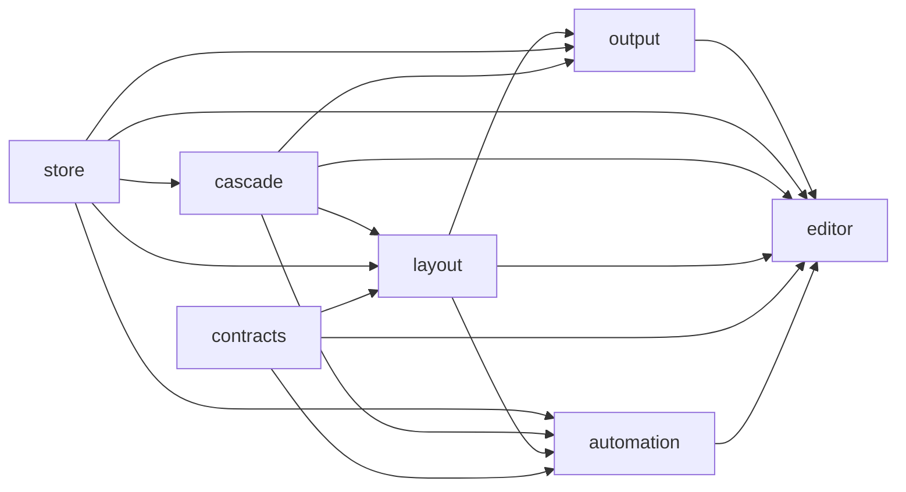

# Engine lanes

The engine is one package, `@pptx-editor.dev/core`, divided into guarded lanes under `packages/core/src/`. The machine-readable source of truth is `packages/core/src/__tests__/core-lane-graph.ts`.

| Lane | Directory | May import | Environment |
| --- | --- | --- | --- |
| `contracts` | `src/contracts` | — | browser (types only; `editor.ts` names `HTMLElement`, and every other module is DOM-free: `automation` imports `neutral.ts`, never `index.ts`) |
| `store` | `src/store` | — | neutral |
| `cascade` | `src/cascade` | store | neutral |
| `layout` | `src/layout` | contracts (the DOM-free font configuration types), store, cascade | neutral |
| `automation` | `src/automation` | contracts (the command and selection types), store, cascade, layout | neutral |
| `output` | `src/output` | store, cascade, layout | browser |
| `editor` | `src/editor` | contracts, store, cascade, layout, automation, output | browser |

## Responsibilities

- **`store`** — the bounded OPC/XML trust boundary, the canonical tree per part, the op vocabulary, the transactional store, and the embedded-font decoder. The source of truth.
- **`cascade`** — PresentationML inheritance and theme resolution. Produces `ResolvedSlide`.
- **`layout`** — geometry from the spec's guide formulas (the evaluator is in `@eigenpal/ooxml-core`, `drawingml-geometry.ts`), HarfBuzz text measurement, the measured line rules, and positioned records. Never paints.
- **`automation`** — the edits that need no DOM (`commands/`: slides, shapes, text, formatting, tables, sections, and autofit, each over an `OpBatch` that lowers to store ops), and the automation host that runs Office.js-shaped batches over them on a server or in a browser. After DOCX Editor's `core/src/automation`.
- **`output`** — the SVG painter over layout records. Never re-derives geometry.
- **`editor`** — the browser composition root: document session, facade, selection, commands, and the chrome registry.

## Enforcement

- `core-lane-graph.test.ts` proves the DAG is acyclic, every lane has source, relative imports cross only declared edges, every lane is exactly one package subpath and one build entry, and neutral lanes name no DOM globals or DOM element types.
- `core-lane-imports.test.ts` reads every import of every lane: static, side-effect, dynamic (also as a template literal), `import x = require`, `import('m').T` in a type, and package subpath (`@pptx-editor.dev/core/<lane>`). A value import must follow `mayImport`. A type-only import must follow `mayImport` or `mayImportTypes`, or be pinned by file in `GRANDFATHERED_TYPE_EDGES` with a reason. The pins ratchet in both directions, so a new edge fails until pinned and a stale pin fails until removed. Both pin lists are empty today. No lane may import the package root (`src/index.ts` or `@pptx-editor.dev/core`), and every import must name a literal module. A failure names the file, the line, the statement, the rule, and the fix.
- `browser-bundle-graph.test.ts` walks the real import graph from every browser entry point: each code subpath of `@pptx-editor.dev/core`, and the roots of `@pptx-editor.dev/react` and `@pptx-editor.dev/vue`. It follows re-export barrels and workspace packages, and proves that no entry reaches `BROWSER_FORBIDDEN_DEPENDENCIES` (`yjs`, `y-protocols`, `pdfkit`, `pdf-lib`, `fontkit`, `node:fs`, `node:net`, `node:http`, `@pptx-editor.dev/pro`), any Node builtin with or without the `node:` prefix, `@pptx-editor.dev/pro`, or `@pptx-editor.dev/pptx-to-pdf`. A walk with an import it cannot follow fails. Every runtime dependency of `packages/pro` and `packages/pptx-to-pdf` must be in the forbidden list. A failure prints the import chain from the entry to the offending import. A control case proves that the check fires.
- Both tests read imports through `import-scan.ts`, which parses each file with the TypeScript compiler, so comments, strings, and long import lists cannot hide an import.
- `consumer.test-d.ts` imports `@pptx-editor.dev/core`, `/editor`, `/contracts`, `/cascade`, `/layout`, `@pptx-editor.dev/react`, and `@pptx-editor.dev/vue` by package name, as a host does. It checks the `createPptxEditor` options and instance, the `fonts` option, commands and results, and the `PptxEditor` props of both adapters. `bun run typecheck` compiles it against the sources through `packages/core/tsconfig.consumer.json`. `bun run check:consumer-types` compiles it against the built `dist/*.d.ts` through each `package.json` `exports`, after `bun run build:packages`; CI runs it in the build job.
- `bun run check:lane-boundaries` compiles `store`, `cascade`, `layout`, and `automation` against a DOM-free `lib`.
- Every guard resolves lane paths through `existingLanePath` (exported by `core-lane-graph.ts`), which throws when a lane moves.

The three guards above are adapted from DOCX Editor's `packages/core/src/__tests__/` at commit `5993bd223`. They differ on purpose in four ways: the TypeScript parser in place of the regex scanner, the package-root and computed-import rules, bare Node builtins, and the check against the built declarations.
