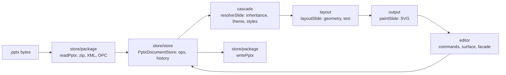

# Repository map

This page tells you where everything is in PPTX Editor. Read [`AGENTS.md`](../AGENTS.md) first: it holds the rules. This page holds the map.

## Start here

Read these in order before you change anything:

1. [`AGENTS.md`](../AGENTS.md): the repository entry point and shared rules.
2. This page.
3. The maintained requirements in [`openspec/specs/`](../openspec/specs/).
4. For rendering work: [`CONTRIBUTING.md`](../CONTRIBUTING.md#fidelity-harness) (the fidelity harness, reference PDFs, thresholds, the gate), the known approximations of [`docs/site/content/pptx-fidelity.mdx`](site/content/pptx-fidelity.mdx), and [`reference/quick-ref/`](../reference/quick-ref/).
5. What works, by presentation feature: [`docs/site/data/pptx-features.ts`](site/data/pptx-features.ts).

## Top-level layout

| Path | What it holds |
| --- | --- |
| `packages/core/` | The engine: parse, store, cascade, layout, paint, save, and the editor facade. Published as `@pptx-editor.dev/core` |
| `packages/vue/` | The Vue 3 adapter twin (`@pptx-editor.dev/vue`, published): Root, Viewport, Content (`components.ts`), composables (`composables.ts`, `useFonts.ts`, `useFontFamily.ts`), toolbar, the `popups` registry (`popups.ts`), dialog parts (`dialog-parts.ts`), the root's `colorMode` and `useEditorColorMode` (`color-mode.ts`), the Page setup dialog (`PageSetupDialog.ts`), and the shared chrome parts that are twins of React's: `chrome.tsx` (`Icon`, `ToolButton`, `Popover`, `MenuItem`), `slot-override.ts`, `ColorSwatches.tsx`, `dialog-color.tsx` (`ColorField`), `dialog-form.tsx` (`FormDialog` and its fields), the form dialogs (`ParagraphDialog.tsx`, `FontDialog.tsx`, `BulletsAndNumberingDialog.tsx`, `ColumnsDialog.tsx`, on the draft in `form-draft.ts`) and `BackgroundDialog.tsx`, `menu-row.tsx` (`MenuRow`, `MenuSeparator`, `MenuSubmenu`), `menu-rows.tsx` (`SlotMenuRow`, `MenuEntries`), the menus `menu-parts.tsx` (`PptxEditorMenu`), `ContextMenu.tsx`, `context-menu-parts.tsx` (`PptxEditorContextMenu`), `CanvasContextMenu.tsx` (the canvas menu that `PptxEditorContent` binds), and `RailContextMenu.tsx` (`RailContextMenu`, `SectionContextMenu`), `pane-state.ts` (`useNotesPane`), `notes-target.ts`, `slot.ts`, and the overlays `FindBar.tsx` (`PptxEditorFindBar`), `EditNotice.tsx`, `FontNotice.tsx`, `HyperlinkPopup.tsx` (the root hosts its `LinkPopupHost`) and `HyperLink.tsx` (`PptxEditorHyperLink`, `useHyperlinkPopup`), and `Slideshow.tsx` (`PptxEditorSlideshow`, `useSlideshow`), over core's `editor/overlays.ts` and `editor/slideshow-screen.ts`. The toolbar, panes, ribbon, status bar, loading screen, picture dialogs, and insert controls are in the rows of their React twins below. Parity-gated against React by `scripts/parity/` (props, emits, slots, and exports) and `scripts/check-adapter-mirror.mjs` (a React twin for each source file) |
| `packages/react/` | The React adapter: provider, hooks, toolbar, panes, menus. Holds no editing state. Published |
| `packages/i18n/` | User-facing strings. `en.json` is the source of truth. `locales/ja.json`, `locales/ko.json`, and `locales/zh-CN.json` are the Japanese, Korean, and Simplified Chinese catalogs (ja and zh-CN reuse DOCX Editor's translations where the strings match), published as the `/ja`, `/ko`, and `/zh-CN` subpaths. Published |
| `packages/editor-api/` | Presentation automation (`@pptx-editor.dev/editor-api`, EigenPal Pro License): an Office.js-shaped batching object model over the automation host, on a server (`createServer`) or over a live editor (`createBrowser`, `/browser`), as DOCX Editor's `editor-api`. The object model is in `src/model/` (one module per Office.js area, for example `tables.ts`, `table-cell.ts`, `table-format.ts`, `table-options.ts`, `adjustments.ts`, `custom-properties.ts`, `custom-xml.ts`, `bindings.ts`, `application.ts`, and `type-names.ts`, the Office.js type name of each class for `loadRecursive`). `compat/` measures it against a pinned Office.js type inventory. `compat/fixtures/source-compat/README.md` records the Microsoft example sources and license scope; `MICROSOFT-LICENSE.txt` preserves their MIT terms. See `packages/editor-api/README.md` |
| `packages/pptx-to-pdf/` | PPTX to PDF on Node.js (`@pptx-editor.dev/pptx-to-pdf`, EigenPal Pro License), painted from the engine's layout with `pdf-lib`, as DOCX Editor's `docx-to-pdf`. `src/cjk-font.ts` loads Noto Sans CJK JP from the optional peer `@docx-editor.dev/fonts-cjk` for decks with East Asian text. Published |
| `packages/pro/` | Review, collaboration, and drawing as `EditorModule`s (`@pptx-editor.dev/pro`, EigenPal Pro License). `src/drawing/` is the `@pptx-editor.dev/pro/drawing` entry: glow, inner shadow, reflection, and soft edge, and charts (the chart modules ported from DOCX Editor, with `chart-elements.ts` lowering a chart to resolved shapes for the engine's layout), installed through `layout/drawing-renderers.ts`. Published |
| `packages/ooxml-core/` | The format-neutral OOXML package layer (`@eigenpal/ooxml-core`): bounded zip, OPC names, the bounded and one-pass XML readers, sinks, limits, SHA-256, image headers, the text units (grapheme clusters, word segments, the caret word rule), the DrawingML color models and transforms, and the DrawingML geometry evaluator with the ECMA-376 preset table. Private; `core` inlines it at build time. Each module except `image-size.ts`, `metafile.ts`, and the `drawingml-*` color and geometry modules is a copy of a DOCX Editor file; its header names the source path and commit |
| `examples/vite/` | The React demo app (`bun run dev`, port 5274), the sample and blank decks, and the fidelity harness page. `DiscardDialog.tsx` asks before New or Open replaces unsaved edits (a `.vue` twin in `examples/vue/`) |
| `examples/vue/` | The Vue demo app (`bun run dev:vue`, port 5275): the twin of the React demo, with the same shell, menus, and decks over `@pptx-editor.dev/vue` (one `.vue` file for each React demo component) |
| `examples/chat/` | A chat app with the editor in a panel beside it (`bun run dev:chat`, port 5276): a scripted assistant, a deck card with a live thumbnail, a resizable panel that switches between the rail layout and a stacked layout with a horizontal slide rail, and a full-window sheet on a phone. It reuses the decks in `examples/vite/public/` |
| `examples/nextjs/` | The Next.js App Router demo (`bun run dev:nextjs`, port 3000) over the built packages; its `vercel.json` deploys it |
| `examples/shared/` | CSS that more than one demo uses: `shell.css` (the `demo-` shell, its `<main>` landmark and visually hidden heading, theme toggle, and adapter switcher). Each demo imports it from its own `src/styles.css`, after the adapter stylesheet. `demo-files.ts` is the framework-free file handling of both demos (the decks, `?deck`, `?theme`, `?chrome`, download, and the PPTX, PDF, PNG, ZIP, and SVG exports); it imports only `@pptx-editor.dev/core`. `pdf-export-plugin.ts` serves `api/convert.ts` from both Vite development servers |
| `vercel.json` | The preview deploy: `bun run build:preview` puts the React demo at `/react/` (also `/`) and the Vue demo at `/vue/` in `examples/parity/dist/`, and `bun run build:pdf` builds the converter for the PDF export function |
| `api/convert.ts` | The demos' PDF export function (`POST /api/convert`): PPTX bytes in, PDF bytes out, through `@pptx-editor.dev/pptx-to-pdf` on Node.js. `convert.node.test.mjs` tests it against the built package |
| `e2e/` | `browser.spec.ts`, the Playwright checks that need a real browser (canvas pixels of the PNG exports, CSS layout boxes), against the React demo (port 5297), and the browser benchmark. Every other demo flow is a happy-dom test |
| `scripts/` | Gates, the fidelity harness, fixture and sample builders, release checks, benchmarks |
| `scripts/harfbuzz-notices.mjs`, `packages/core/licenses/` | HarfBuzz component notices, pinned provenance, and release checks for dependency versions and binary hashes |
| `fixtures/` | Synthetic `.pptx` fixtures, one per feature, built by `bun run fixtures:build`, and `fixtures/fonts/`, the open fonts (with their license) that the fixtures name and the engine does not ship. CI uses only these |
| `reference/ecma-376/` | ECMA-376 schemas and preset geometry definitions (Ecma material, see its `NOTICE`) |
| `reference/quick-ref/` | PresentationML, DrawingML, and theme quick references (DOCX Editor format) |
| `docs/repo-map.md` | This page |
| `docs/architecture/` | Contributor docs on the engine design: `engine-lanes.md` (the lane DAG) |
| `docs/api/` | API Extractor snapshots, one folder per package |
| `docs/site/content/` | Public developer documentation. Getting started, `frameworks/`, `react/`, and `vue/` cover integration. `customization/` holds task guides, with component tables in `customization/reference/`. `guides/` covers file handling and presentation editing. `recipes/` holds task recipes; `examples.mdx` links runnable integrations. `export/pdf/`, `pro/`, and `editor-api/` cover licensed packages. `core/` and `i18n/` hold engine and localization references. `meta.json` files set navigation. Follow `AGENTS.md` and `docs/site/README.md`; update pages with the API they describe. |
| `docs/site/data/` | The feature matrix (`pptx-features.ts`, synced to the docs site), the evidence of each row (`pptx-feature-evidence.ts`: fixtures and approximation ids), the saved fixtures and feature edits that opened with no repair prompt (`save-verified-fixtures.ts`), and the evidence and approximation tests (`pptx-features.test.ts`). `navigation.test.ts` checks page metadata, sidebar coverage, and internal page links. `fidelity-page.test.ts` checks the `<FeatureMatrix>` and `<FeatureBadge>` tags and the `docsLink` of each row. `docs/site/README.md` says what the docs site provides |
| `openspec/` | Maintained specifications in `specs/`. |
| `.changeset/` | Pending release notes, one per code change |
| `.github/` | CI (`ci.yml`), release and nightly canary (`release.yml`), post-release comments (`post-release.yml`), the CLA check (`cla.yml`, logic and tests in `.github/cla/`), Dependabot |
| `signatures/` | Signed CLA records, written by the CLA check (`signatures/version1/cla.json`) |

Never commit, and never read into committed files:

| Path | Why |
| --- | --- |
| `demo-presentations/` | Real client decks (the private corpus). Local checks only; name decks `deck1`–`deck8` |
| `fidelity-report/`, `test-results/`, `.cache/`, `packages/*/dist/`, `examples/*/dist/`, `examples/parity/`, `examples/nextjs/.next/`, `examples/nextjs/public/` | Generated output |

## The engine pipeline

The fidelity harness (`scripts/fidelity/`) and the editor call the same pipeline. There is no second renderer.

## `packages/core/src`, lane by lane

Each directory is a lane with allowed imports (`src/__tests__/core-lane-graph.ts`, [`architecture/engine-lanes.md`](architecture/engine-lanes.md)). `store`, `cascade`, and `layout` are DOM-free.

### `store/`: the only write path

| Module | Purpose |
| --- | --- |
| `@eigenpal/ooxml-core` (`packages/ooxml-core/src/`) | Bounded zip read and write (`zip.ts`, `zip-write.ts`), OPC part names, resource caps, safe XML parse with no DTD (`xml-reader.ts`, the one-pass `xml-fast-read.ts`, `xml-text.ts`), checked escaping and `sanitizeHref`, SHA-256, image headers (`image-size.ts`: PNG, JPEG, GIF, BMP, and WebP sizes; `metafile.ts`: the EMF and WMF signatures and picture frames), UAX #29 grapheme clusters and word segments (`grapheme.ts`, `word-segment.ts`), the caret word rule (`caret-word.ts`), the DrawingML color models, transforms, and preset colors (`drawingml-color.ts`, `drawingml-preset-colors.ts`), and the DrawingML geometry: guide formulas, paths, the text rectangle, the `a:custGeom` reader, and the preset table generated by `scripts/geometry/build-presets.ts` (`drawingml-geometry.ts`, `drawingml-preset-geometry.generated.ts`, `drawingml-preset-geometry-types.ts`), and the preset adjust handles: their places and the values for a handle place (`drawingml-handles.ts`). Format-neutral: no PresentationML imports |
| `package/xml-names.ts`, `serialize.ts` | Name rules, serialization with checked escaping |
| `package/package.ts`, `presentation.ts`, `tree.ts`, `query.ts`, `node-kinds.ts` | The package model, slide list, canonical tree, read helpers, typed node kinds |
| `package/deferred-parts.ts` | Deferred XML parts of a progressive open: a slide or notes slide kept as its bytes that parses on first read, the `show` attribute read from its start tag, and the stand-in and refusal of one that does not parse (`writePptx` refuses to write it) |
| `package/presentation-repair.ts` | The presentation part as the writer emits it: one `p:extLst`, one section list, each slide in one section, one entry per slide part with unique slide ids |
| `package/table-grid.ts` | The merge grid of an `a:tbl`: which positions each drawn cell covers, from spans only. The cascade, the table commands, find, and the part checks read it, `tableMergeFaults` lists where merge markup disagrees with it, and `editedTableGrid` is the grid a table command writes (spans trimmed by `tableSpanTrims`). Format-neutral |
| `package/table-marks.ts` | The structure mark of a table frame in a collaboration room (`TABLE_EDIT_URI`, `isStructureEdited`), `tableGridOf`: the one merge grid the cascade, the table commands, find, and the save read for a frame, `tableCellCounts` and `addedTableCell`: the save's cell-count repair and the blank cell it adds, `cellAsSaved`: a cell's text bodies joined as the save joins them, `tableAsDrawn`: the cells and grid the cascade and find read, a marked table as the save writes it, and `isEmptiedTable`: a marked table that concurrent deletes left with no column or row, which the cascade does not draw, the selection pane does not list, and the save leaves out |
| `package/timing.ts` | The shapes a slide's animations name (`p:timing`), the timing entries that go when shapes go (`timingRemovals`), and the writer's repair of a `p:timing` that the session changed (no empty time node list or build list); a `p:timing` as the file wrote it saves unchanged |
| `package/namespaces.ts` | Namespace table |
| `store/document-store.ts` | `PptxDocumentStore`: transactions, undo and redo with history groups and selection marks, listeners |
| `store/history-group.ts` | The store `HistoryGroup` token and `TransactOrigin` (`projection` and `awareness` record no history) |
| `store/part-checks.ts` | The PresentationML checks of the parts a transaction touched (tables, shape ids, the slide list, relationship targets, content types), run before a commit; a violation the transaction introduced refuses it |
| `store/ops.ts`, `op-checks.ts`, `tree-edit.ts`, `working-tree.ts`, `node-index.ts` | The `PptxOp` set, its validation, and fast tree edits |
| `fonts/` | Embedded fonts: EOT, MicroType Express, CTF, glyf, sfnt |

### `cascade/`: PresentationML inheritance

| Module | Purpose |
| --- | --- |
| `slide.ts` | The only module that knows inheritance: master → layout → slide placeholders, `clrMap`, `p:style` |
| `resolve-keys.ts` | The cache keys of the slide resolve: what an element reads outside its own XML, compared by identity, so an edit resolves only the elements it changed |
| `alternate-content.ts` | The `mc:AlternateContent` branch that the cascade, find, the selection pane, the layout commands, and the edit rule of `automation/commands/alternate-copies.ts` read (ECMA-376 Part 3, 10.2.1) |
| `text-style.ts` | List styles, paragraph and run properties, fields |
| `theme.ts`, `color.ts` | Theme colors and fonts; color resolution through the color map (`p:clrMap`) and `phClr`. The color math is in `@eigenpal/ooxml-core` (`drawingml-color.ts`) |
| `script-fonts.ts` | The ISO 15924 script of a run's language (`lang`, `altLang`), which picks a theme script font (`a:font`) for the `ea` and `cs` slots |
| `paint-props.ts` | Fills, lines, effects |
| `chart-part.ts` | The chart part (`c:chartSpace`) behind a chart frame, parsed read-only from the part's bytes |
| `table.ts`, `table-styles.ts` | Tables and table styles |
| `diagram.ts` | The data model and saved drawing parts behind a diagram frame (`dgm:relIds`, `dsp:dataModelExt`), parsed with the bounded reader. `slide.ts` resolves the drawing's shapes as slide shapes |
| `types.ts` | The resolved types layout and paint read |

### `layout/`: DOM-free geometry and text

| Module | Purpose |
| --- | --- |
| `slide-layout.ts`, `item-layout.ts`, `matrix.ts` | `layoutSlide`: positioned items, transforms, groups. `item-layout.ts` lays out one element (and `relayoutItem`, one item again at a new box, for the drag preview; not on the `layout` subpath); `matrix.ts` holds the affine matrices |
| `autofit.ts` | `fitShape`: the `spAutoFit` size and the `normAutofit` scale of a shape at its box, with nothing written; `automation/commands/autofit.ts` writes them, and `relayoutItem` previews them. Not on the `layout` subpath |
| `geometry/geometry.ts` | `evaluateGeometry`: the cascade's geometry spec and the canonical tree over the geometry evaluator, which is in `@eigenpal/ooxml-core` (`drawingml-geometry.ts`, with `presetAdjustments`: the adjust values of a preset with its handle ranges) |
| `line-strokes.ts` | Dashes and line ends (`a:prstDash`, `a:custDash`, `a:headEnd`, `a:tailEnd`), measured on reference PDFs: the dash array of each cap, where a line stops under a head, and the outline of each head. The SVG paint (`output/paint.ts`) and `pptx-to-pdf` both draw from `planStroke` |
| `text/text-layout.ts`, `line-break.ts`, `font-slots.ts`, `autonumber.ts`, `anchor.ts`, `symbol-encoding.ts` | Line breaking (East Asian rules of `eaLnBrk`, `latinLnBrk`, `hangingPunct`, and `p:kinsoku` lists; East Asian justification), the font slot of each character (`a:latin`, `a:ea`, `a:cs`, `a:sym`), bullets and numbering (Wingdings and Symbol bullets' Unicode twins, copied from DOCX Editor), vertical anchoring |
| `text/measurer.ts`, `harfbuzz-measurer.ts`, `advance-cache.ts`, `line-metrics.ts`, `face-line-metrics.ts` | The injected `TextMeasurer`, HarfBuzz shaping, the measured line rules, the line metrics of missing faces |
| `harfbuzz-wasm-binary.ts`, `node-module-shim.ts` | How the bundled HarfBuzz finds its WASM (`setHarfBuzzWasmUrl`) |
| `table-layout.ts` | Table rows and cells |
| `drawing-renderers.ts` | `installDrawingRenderers` and `drawingRenderers`: the renderers a capability package installs (the Pro `effects` and `chart` renderers). `drawingCapabilities` says what they paint, for the chrome, and `subscribeDrawingRenderers` tells the adapters when an install changes it. DOM-free: an effects renderer returns SVG as plain data, and a chart renderer returns resolved shapes that `layoutSlide` lays out in the frame |
| `approximations.ts` | The catalog of known approximations (kept equal to the known approximations of `docs/site/content/pptx-fidelity.mdx` by a test; matrix rows name its ids) |
| `font-resource.ts`, `font-composition.ts`, `font-resolver.ts`, `font-deferred.ts`, `defer-fonts.ts`, `supported-font-families.ts` | Font configuration copied from DOCX Editor: admission limits and the sfnt check, `composeFontConfiguration`, `composeFontOrigins` and the resolver mark, and late faces |

### `automation/`: DOM-free edits

The edits that need no DOM, after DOCX Editor's `core/src/automation`. Each takes an `OpBatch` and lowers to store ops, so the editor's commands and the automation host share one implementation. `bun run check:lane-boundaries` compiles the lane without the DOM library.

| Module | Purpose |
| --- | --- |
| `protocol.ts`, `operations.ts` | The automation protocol: object kinds, opaque handles, result references, error codes, read values, and the `AutomationOperation` union |
| `host.ts` | `createAutomationHost`: one atomic batch per request, a revision check, and events after the batch |
| `server-host.ts` | `createServerAutomationHost` and `createStoreAutomationHost`: a host over bytes or a `PptxDocumentStore`, with no DOM |
| `handles.ts`, `targets.ts`, `text-offsets.ts` | The handle table with its host token, and the lookup of a handle in the working package |
| `plan.ts`, `plan-reads.ts`, `plan-slides.ts`, `plan-shapes.ts`, `plan-text.ts`, `plan-tables.ts`, `plan-properties.ts`, `plan-custom-properties.ts` (custom document properties), `plan-custom-xml.ts` (custom XML parts), `plan-import.ts` (slides from another presentation), `plan-images.ts` (the check of a slide or shape picture), `plan-backgrounds.ts` (slide, layout, and master backgrounds), `plan-theme.ts` (theme colors), `plan-table-format.ts` (cell borders and margins, table style options and style), `plan-adjustments.ts` (preset adjust values), `plan-bindings.ts` (bindings: ids that name shapes, kept by the host in memory and never saved) | The planner: each operation as a read of the working package or as store ops. Text, font, paragraph, and fill operations take an optional table `cell` address |
| `commands/table-insert.ts`, `table-repair.ts` | A new table frame, and a table made valid again after concurrent edits and on save |
| `commands/op-batch.ts`, `package-edits.ts` | The op batch over a working package, `CommandRefusal`, relationships, content types, free part names, and shape ids |
| `commands/slide-commands.ts`, `slide-multi.ts`, `slide-structure.ts`, `slide-import.ts`, `import-comments.ts`, `slide-layouts.ts`, `slide-sections.ts`, `slide-numbers.ts`, `header-footer.ts`, `notes-commands.ts`, `slide-size.ts` | Slides: add, duplicate, import from another presentation (with comments and their authors), delete, move, background, layouts and placeholder re-mapping, sections, slide numbers, footers and dates, speaker notes, and the slide size with its content scale |
| `commands/shape-commands.ts`, `shape-presets.ts`, `style-commands.ts`, `effect-commands.ts`, `arrange-commands.ts`, `group-commands.ts`, `placement.ts` | Shapes: insert, transform, order, fill, line, effects, arrange, and groups |
| `commands/text-model.ts`, `text-units.ts`, `text-diff.ts`, `find.ts`, `font-format.ts`, `paragraph-format.ts`, `list-commands.ts`, `autofit.ts` | Text: runs and paragraphs, caret units, find and replace, font and paragraph formats, lists, and the autofit re-fit that writes the `layout/autofit.ts` results (ECMA-376 Part 1, 21.1.2.1) |
| `commands/table-model.ts`, `table-format.ts`, `table-fit.ts`, `table-edit-marks.ts` | Tables: the grid, merges, rows and columns, cell format, and the frame size after an edit |
| `commands/base64.ts` | Base64 for binary parts carried in ops |

### `output/`: SVG paint

`paint.ts` (`paintSlide`, and `SlidePainter`, which keeps the SVG nodes of unchanged layout items between paints), `metafile-png.ts` (an EMF or WMF picture as a PNG with `emf-converter`, imported lazily and with no DOM; the editor, the image export, and `pptx-to-pdf` use it), `paint-fill.ts`, `paint-gradient.ts` (linear and path gradients), `paint-effects.ts`, `paint-text.ts`, `paint-table.ts`, `compound-lines.ts`, `preset-patterns.ts`, `effect-transforms.ts`, `font-faces.ts`, `svg.ts`, `svg-document.ts` (a DOM-free SVG document and serializer, so a host with no DOM runs the same paint). `painter-math.ts` holds the `@internal` rules that `pptx-to-pdf` and `pro/drawing` share with this paint. `paint-effects.ts` paints the outer shadow and builds what the installed effects renderer returns; without it, glow, inner shadow, reflection, and soft edge do not paint.

### `contracts/`

`index.ts`: the public entry; it re-exports `neutral.ts` and `editor.ts`. `neutral.ts`: the DOM-free public types: `EditorCommand`, `EditorSnapshot`, selections. Adding a command or a snapshot field starts here. The automation lane imports it directly, never `index.ts`. `editor.ts`: the `Editor` contract, the only one that names a DOM type (`HTMLElement`). `shape-format.ts`: the Shape Format types (effect presets, Quick Styles cells, `ShapeSummary`), re-exported by `index.ts`. `table.ts`: the table types (`TableContext`, `TableBorderSpec`, cell addresses), re-exported the same way. `editor-fonts.ts`: the font configuration types (`FontConfiguration`, `FontSource`, `EditorFontErrorCode`), copied from DOCX Editor; the `layout` lane reads them too. `history-group.ts`: the `HistoryGroup` handle and `EditorExecOptions`, after DOCX Editor's `contracts/editor-scope.ts`. `clipboard.ts`, `find.ts`, and `header-footer.ts`: the shape clipboard format (`ClipboardPayload`), the find options and matches, and the slide targets and date state of the slide-number, footer, and date commands, re-exported by `neutral.ts`.

### `editor/`: the facade and everything interactive

| Area | Modules |
| --- | --- |
| Facade and session | `pptx-editor.ts` (`createPptxEditor`), `surface-host.ts` (the `SurfaceHost` the facade gives the surface, and the surface's key handler), `pptx-editor-types.ts` (`PptxEditorOptions`, `PptxEditorInstance`), `document-session.ts`, `progressive-open.ts` (the background parse of a long deck after its first slide, after DOCX Editor's opening slices: 12 ms tasks that end early for input, the slides in view first), `pptx-editor-opening.ts` (the facade's side of it: start, finish for save, the pending count, the read-only state after damage, and the fonts of late slides), `clipboard-host.ts` (copy, cut, and paste events), `snapshot-sources.ts` (notes, font substitutions, and the font family list), `host-fonts.ts` (the host's `fonts` origins for one editor: composition, admission, `setFonts`, picked families, and `withFontOrigin`), `deck-font-request.ts` (the families and default family a deck asks the origins for), `open-steps.ts` (the open after the parse: the shaping and host font waits under one deadline, and the faces step), `within.ts` (a promise with a time limit), `late-fit.ts` (text edited on the fixed measurer fits again when shaping starts), `thumbnails.ts`, `thumbnail-queue.ts` (which thumbnails paint first: the ones in view, the rest when they scroll into view or when idle), `slide-dependencies.ts`, `paint-ids.ts` |
| Adapter support | `adapter-support.ts` (empty snapshot, command state, shortcut text, toolbar arrangement), `editor-events.ts` (`onEditorEvent`: typed events derived from the one `subscribe`), `bind-history-group.ts` (`bindHistoryGroup`: one undo step for one gesture on a host control, behind `useHistoryGroup`), `document-search.ts` (the find session with no UI behind `useDocumentSearch`), `pptx-source.ts` (the source and font rules behind `usePptxSource`), `editor-ref.ts` (the members of the adapters' imperative `PptxEditorRef`), `loading.ts` (when the loading screen shows, its sheet size, and the frame `load` yields before the parse), `progressive-mount.ts` (how many rail items mount while a long deck opens, in steps of about 8 ms), `toolbar-layout.ts` (named parts table, group priorities, the collapse rule), `toolbar-controls.ts` (which part draws a slot, dropdown rows, the split color default, the size box, and the More menu fit), `dialog-draft.ts` (the dialog draft controller and part markers), `dialog-fields.ts` (field rules of the packaged dialogs), `palette.ts`, `menu-keyboard.ts`, `dev-warnings.ts`, `paragraph-dialog-fields.ts`, `font-dialog-fields.ts`, `bullets-dialog-fields.ts`, `columns-dialog-fields.ts`, `page-setup-fields.ts`, `color-fields.ts` (the dialogs' form models and the color field), `chrome-popover.ts` (popover and submenu placement, focus, and dismissal), `fixed-frame.ts` (fixed chrome inside a transformed, scaled, or clipping host: the frame origin, scale, and visible area), `chrome-tooltip.ts` (the chrome tooltip: the `data-pptx-tooltip` attributes, the hover and focus timing, and the bubble placement), `font-picker.ts` (the font family picker's groups: theme fonts, the fonts in this presentation, and all fonts), and `chrome-forms.ts` (swatch grid keys and selection, color field labels, form dialog errors and tabs, menu row check state, and the focused notes field), `menu-arrangement.ts` (the named menu rows tables, which registry rows a host row replaces or hides, the menu bar's menus and keys, context menu placement, and the slide and section menu rows), and `form-dialog-support.ts` (the form dialogs' error messages and list options, the Background status line, and the tab a menu row opens a dialog on): shared by the React and Vue adapters |
| Capability modules | `modules.ts` (with `store/store/replica-part.ts`, the collaboration trust boundary): the closed `EditorModule` seam (review, collaboration) and `CollaborationDocumentPort`, after DOCX Editor's `contracts/modules.ts`. `collaboration-status.ts` (status tracker, failure codes) and `collaboration-presence.ts` (publishes the selection, follows it, converts addresses) |
| Commands | `commands.ts` (compiles every `EditorCommand`), `command-types.ts` (`EDITOR_COMMAND_TYPES` and `TEXT_INPUT_KINDS`: every command type and text input kind as a value, checked against the unions by the compiler), `automation/commands/op-batch.ts`, `automation/commands/package-edits.ts`, `automation/commands/shape-commands.ts`, `automation/commands/style-commands.ts`, `automation/commands/group-commands.ts`, `automation/commands/slide-commands.ts`, `automation/commands/slide-structure.ts`, `automation/commands/slide-multi.ts`, `automation/commands/slide-layouts.ts` (the deck's layouts, change layout and reset by placeholder re-mapping), `slide-command-table.ts` (layout, reset, hide, notes format, section, and slide size commands), `shape-command-table.ts` (`setAdjustments`, `setShapePattern`, `setShapePicture`), `automation/commands/fill-commands.ts` (pattern and picture fill XML, the pattern names, and the picture type check, shared with the Office.js lane), `pattern-fields.ts` (the pattern dialog's gallery order, names, and swatches), `automation/commands/adjust-commands.ts` (writes preset adjust values), `automation/commands/slide-sections.ts` (`p14:sectionLst`: add, rename, remove, remove all, move), `view-settings.ts` (smart guides, the Normal or Slide Sorter view, and the collapsed sections), `automation/commands/slide-numbers.ts`, `automation/commands/header-footer.ts` (`setFooter`, `setDateTime`, the slide targets, the snapshot reads, and the dispatch of the three Insert menu commands), `automation/commands/notes-commands.ts` (notes text and formatting), `automation/commands/text-diff.ts` (the changed regions of a text field), `automation/commands/list-commands.ts`, `automation/commands/actor-scoped-ids.ts` (copied from DOCX Editor) and `replica-ids.ts` (ids minted in an actor's stripe during collaboration), `bullet-format.ts` (`setBulletFormat`, the Bullets and Numbering galleries, and the read), `automation/commands/paragraph-format.ts` (`setParagraphFormat` and its mixed read), `automation/commands/font-format.ts` (superscript, subscript, Change Case, character spacing, `setFontFormat` and its mixed read), `caret-arm.ts`, `format-painter.ts`, `automation/commands/find.ts`, `find-session.ts`, `automation/commands/autofit.ts`, `automation/commands/effect-commands.ts` (shape effects and Quick Styles), `automation/commands/arrange-commands.ts` (distribute, flip, rotate, aspect lock, show, hide, rename), `automation/commands/shape-removal.ts` (`removeShapes`: every shape removal, with the `p:timing` entries and connector ends that name the removed shapes), `automation/commands/alternate-copies.ts` (`withoutStaleCopies`: every commit also removes the copies that an edit leaves out of date in the other branches of `mc:AlternateContent`) |
| Pictures | `picture-commands.ts` (crop, crop to shape, Change Picture, Reset Picture, adjustments, styles, alt text), `picture-presets.ts` (the Recolor presets and picture styles as XML, matched back by signature), `picture-state.ts` (`EditorSnapshot.image` and the alt text in the snapshot), `crop-mode.ts` (the Crop button's state), `picture-fields.ts` (the draft rules of the Alt Text and Format Picture dialogs) |
| Tables | `table-commands.ts` (compiles every `TableCommand`), `automation/commands/table-model.ts` (the grid, merges, row and column and merge and split ops), `automation/commands/table-format.ts` (`a:tcPr` and `a:tblPr`: fill, borders, margins, anchor, style), `automation/commands/table-fit.ts` (frame size after an edit), `table-cells.ts` (a cell as a text item, hit tests), `table-keys.ts` (Tab and arrows between cells, Shift+Arrow into a cell range), `table-clipboard.ts` (cell ranges as tab-separated text and the cells clipboard format, for copy and `pasteCells`), `table-state.ts` (`EditorSnapshot.table`), `automation/commands/table-repair.ts` (a table made valid again after concurrent edits, and on save: cell counts always, merge markers in a table with a structure mark, and no frame for a marked table with no column or row), `automation/commands/table-edit-marks.ts` (writes and removes the structure mark: a collaboration room's structure command changed the table; never saved. A marked table draws and saves by `editedTableGrid`) |
| Tables docs page | `docs/site/content/guides/tables.mdx` (commands, `TableContext`, the `table` slots, in the DOCX Editor page structure) |
| Chrome registry | `chrome-controls.ts` (`CHROME_GROUPS`, `ChromeSlotId`, `toolbarCommandState`; near the 1000-line cap), `chrome-adapter-state.ts` (`adapterActionState`: the state of rows that the adapter runs), `chrome-slot-commands.ts` (`commandForSlot`, `commandForSlotValue`: the command each slot dispatches), `chrome-font-controls.ts` and `chrome-paragraph-controls.ts` (the Font and Paragraph groups' newer controls), `chrome-slide-groups.ts` (the slide and section slots it spreads in, and their probes, values, commands, and refusal reasons), `chrome-table.ts` (the `table` group, with the Table Design and Table Layout controls, and the border pen), `line-presets.ts` (the dash and weight lists that the shape and table chrome share), `chrome-menus.ts` (`CHROME_MENUS`, `CANVAS_CONTEXT_MENUS`), `ribbon.ts` (`RIBBON_TABS`, `ribbonTabs`: the tabs and contextual tabs over the registry's groups), `chrome-picture.ts` (the contextual `image` group), `chrome-actions.ts` (how a row runs: commands, dialogs, clipboard, show; `editorCommandFor`, `valueSlotOptions`, and `valueSlotShown`, shared by the React and Vue `useEditorCommand` and `useEditorValueCommand`), `surface-registry.ts` (which element each editor paints into), `icon-paths.ts` (official Material Symbols only), `shape-gallery.ts`, `theme-palette.ts`, `chrome-shapes.ts` (the Shape Format and Arrange slots), `chrome-offered.ts` (`chromeOfferedControl`: the choices a slot offers in this build, without the effects that no installed drawing renderer paints, but with the rows that remove an effect the selection has), `toolbar-values.ts` (`ToolbarValueMap`, the typed slot values), `shape-list.ts` (`snapshot.shapes` for the selection pane) |
| Surface (canvas) | `placeholder-prompts.ts` (prompt text of empty placeholders, editor only, and the layout gallery previews), `notes-dom.ts` (the notes field as DOM: draw runs, map points to plain offsets; shared by the adapters), `notes-find-highlight.ts` (the find bar's match in the notes field, painted as a CSS custom highlight), `surface.ts`, `surface-drag.ts` (shape drags: the boxes of each pointer move, and `ShapeDrag`, which holds a drag from press to release, its cancels, and the one edit on release), `drag-preview.ts` (the drag preview: the dragged shapes laid out again at their new boxes and painted in place), `surface-geometry.ts` (text frame, caret, hit test), `surface-text-selection.ts`, `surface-presence.ts` (collaboration peers), `surface-input.ts` (keyboard and IME: the composing text shown at the caret, composition keys and late commit events ignored), `surface-table.ts` (clicks, cell ranges, and grid line drags in tables), `surface-table-chrome.ts` (the table's select handle, the marked grid line, and the insert buttons), `surface-handles.ts` (the resize and rotation handles of the selection; a table has no rotation handle), `surface-guides.ts` and `snapping.ts` (smart guides), `surface-ghost.ts` (ghost bullets), `surface-context-menu.ts`, `surface-crop.ts` (crop mode overlay and handles), `surface-adjust.ts` (the adjust handles of a selected preset shape and their drag), `surface-announce.ts` (what the live region says about the selection: the table cell, or the kind, name, and alt text of a shape), `automation/commands/placement.ts` |
| Text editing | `automation/commands/text-model.ts` (runs, the caret word rule), `caret-arm.ts` (a format armed at a caret for the text typed next, as session state), `text-input.ts` (typing, deletion, and caret steps by character, word, and line), `automation/commands/text-units.ts` (caret stops, word segments, and the double-click word of a paragraph, over the shared UAX #29 segmentation), `list-keys.ts`, `shape-keys.ts` (the keys on selected shapes, and what Select All selects), `selection-state.ts`, `history-marks.ts`, `history-groups.ts` (host `HistoryGroup` handles, and the typing, drag, and nudge groups) |
| Slides and rail | `slide-selection.ts` (multi-select), `slideshow.ts`, `slideshow-view.ts`, `slideshow-screen.ts` (full screen and show keys for both adapters), `overlays.ts` (find bar, link popup, and notice rules for both adapters), `link-popup.ts` (the link popup's reading and editing state, shared by `useHyperlinkPopup`, and when a click opens it), `link-fields.ts` (the link form's kinds, email fields, and slide choices), `selection-pane.ts` (the selection pane's rows, tree keys, and selection, and the side panel's tabs), `automation/commands/slide-links.ts` (the `#slide-N` and relative jump forms of `setLink`: the action and slide relationship they write and read) |
| Font configuration (copied from DOCX Editor; each header names the source path and commit) | `load-fonts.ts` (`loadFonts`, `createFontSource`), `custom-fonts.ts`, `font-resolution-lifetime.ts`, `editor-font-error.ts`, and the `font-composition.ts` and `font-resolver.ts` shims over `layout/` |
| Automation | `automation-host.ts` (`createBrowserAutomationHost`: the automation host over a live editor, with its undo history and selection) |
| Other | `clipboard.ts`, `metafile-pictures.ts` (the session's picture bytes: an EMF or WMF part draws as its PNG once converted, then the editor repaints), `export-image.ts`, `render-image.ts` (slide and shape pictures for the automation host: on a canvas in a page, or through a host rasterizer with no DOM), `local-fonts.ts`, `automation/commands/base64.ts` |

### `styles/editor.css`

All chrome CSS and tokens (`--doc-*`, shadcn HSL names shared with DOCX Editor). No hard-coded colors in components; the slide canvas is never themed.

## `packages/react/src`

| Module | Purpose |
| --- | --- |
| `index.ts`, `PptxEditorRoot.tsx` | `PptxEditor.Root/.Viewport/.Content` and the default editor |
| `context.ts`, `slot.ts` | `usePptxEditor`, `useEditorState(selector)`, `useEditorCommand(slotId)`, `useEditorValueCommand(slotId)`, translation |
| `useParagraphFormat.ts`, `useFontFormat.ts`, `useBulletFormat.ts` | `useParagraphFormat()`, `useFontFormat()`, and `useBulletFormat()`: the selection's format and one-command `apply`, as DOCX Editor's hook (Vue twins in `composables.ts`) |
| `useFontFamily.ts` | `useFontFamily()`: the font family picker's behavior with no UI (value, options, the picker's groups from core `font-picker.ts`, and `setValue`), as DOCX Editor's hook (Vue twin in `packages/vue/src/useFontFamily.ts`) |
| `Toolbar.tsx`, `FontFamilyControl.tsx` (the grouped font family picker), `ChromeTooltip.tsx` (the tooltip bubble the root mounts), `toolbar-file-controls.tsx` (the link and image file controls), `ShapeControls.tsx`, `PatternDialog.tsx` (the pattern fill dialog of the fill menu and the Background dialog; the Vue twin has the same name), `ShapeFormatControls.tsx`, `TableControls.tsx`, `ColorSwatches.tsx`, `palette.ts` | The toolbar, derived from `CHROME_GROUPS`, with `Toolbar.Slot`, `Toolbar.Group`, and `preset`; `ShapeFormatControls.tsx` draws Quick Styles (`ShapeStyleGallery`) and the Shape Effects menu |
| `toolbar-parts.tsx`, `slot-override.ts`, `toolbar-named-parts.tsx`, `toolbar-action.tsx` | The customization ladder (DOCX Editor's toolbar parts): slot overrides for `icon`, `className`, and `asChild`, the named parts (`Toolbar.Bold`, …), `Toolbar.Action`, and `Toolbar.Separator` |
| Vue toolbar | `packages/vue/src/toolbar.ts` (`ToolbarSlot`, `ToolbarGroup`, the preset bar and its overrides), `toolbar-bar.tsx` (the bar element and the More menu), `toolbar-controls.tsx` (`ToolbarControl` and the control per shape), `FontFamilyControl.tsx`, `ChromeTooltip.tsx`, `toolbar-size.tsx`, `toolbar-file-controls.tsx`, `toolbar-measure.ts` (roving focus), `toolbar-parts.ts` (named parts, `ToolbarAction`): the twins of the React toolbar files |
| `customization-hooks.ts` | DOCX Editor's hooks for host chrome: `useZoom`, `useEditorEvent` (over core `editor-events.ts`), `useEditorSnapshot`, and `useScopeClassName` (Vue twin `packages/vue/src/customization-hooks.ts`) |
| `headless-hooks.tsx` | More of DOCX Editor's hooks: `useChromeTranslate` and the compounds' `t` prop (`withChromeTranslate`), `useToolbarContext`, `useToolbarLabel`, `useToolbarLabelFor`, `useHistoryGroup`, `useEditorCaret`, and `useDocumentSearch` (Vue twin `packages/vue/src/headless-hooks.ts`) |
| `useHyperlinkPopup.ts` | DOCX Editor's `useHyperlinkPopup` and `useHyperlinkPopupInstance` over core's link popup store, and the root's store contexts (Vue twin `packages/vue/src/useHyperlinkPopup.ts`) |
| `usePptxSource.ts` | `usePptxSource` (the twin of DOCX Editor's `useDocxSource`) and `useEditorHostDocument` (Vue twin `packages/vue/src/usePptxSource.ts`) |
| `popups.tsx` | The `popups` registry: `definePopup`, `useEditorDialog`, and the dialog host inside `PptxEditor.Root` |
| `dialog-parts.tsx`, `color-mode.ts` | Dialog named parts over a draft (`createDialogParts`, `DialogFrame`), ported from DOCX Editor; the chrome scope classes for parts outside the viewport and the root's `colorMode` |
| `panes.tsx`, `pane-state.ts`, `rail-parts.tsx`, `SidePanel.tsx`, `SelectionPane.tsx` | Slide rail, notes pane, zoom, side panel (Format, Selection, Comments), selection pane, with DOCX Editor's pane props; the notes open state the panes share (`useNotesPane`); the named parts of the rail's action row (`SlideRail.AddSlide`, …). Vue twins in `packages/vue/src/`: `panes.tsx`, `rail-parts.tsx`, `SidePanel.tsx`, `SelectionPane.tsx`, `RailSections.tsx`, `slide-drag.ts`, `SlideSorter.tsx`, `NotesPane.tsx`, `NotesView.tsx`, and `rail-memo.ts` (the rail's vnode cache). The keys, drag, and focus rules of both, and the rail item cache (`createItemMemo`), are in `packages/core/src/editor/pane-support.ts`. The drag image of a slide drag is in `packages/core/src/editor/slide-drag-image.ts`. `packages/core/src/editor/notes-inset.ts` keeps the default editor's status area and font notice above the notes card |
| `ContextMenu.tsx`, `RailContextMenu.tsx`, `CanvasContextMenu.tsx`, `context-menu-parts.tsx` | Right-click menus: the positioned menu, the rail menu, the canvas menu request, and `PptxEditor.ContextMenu` |
| `menu-parts.tsx`, `menu-rows.tsx`, `chrome-actions.tsx` | `PptxEditor.Menu` (the menu bar), slot rows shared with the context menu, and the adapter actions behind dialog, clipboard, show, find, and link slots; the root's link popup host |
| `HyperlinkPopup.tsx`, `HyperLink.tsx` | The link popup (`popups.hyperlink`): `PptxEditor.HyperLink` with its named parts, `useHyperlinkPopup` |
| `Ribbon.tsx`, `StatusBar.tsx` | `PptxEditor.Ribbon` (the tabs over the toolbar's preset bar, `PresetBar` in `Toolbar.tsx`) and `PptxEditor.StatusBar` (slide x of y, notes, the view switch, and the zoom pill); Vue twins in `packages/vue/src/ribbon.ts` and `status-bar.ts` |
| `chrome.tsx` | `Icon`, `ToolButton`, `Popover`, `MenuItem`, `keepFocus` |
| `Loading.tsx` | `PptxEditor.Loading`: the slide-shaped loading screen and its spinner; Vue twin in `packages/vue/src/loading.ts` |
| `Slideshow.tsx`, `FindBar.tsx`, `EditNotice.tsx`, `FontNotice.tsx`, `OpenFailure.tsx` (the notice when a file does not open; a twin in Vue), `BackgroundDialog.tsx`, `PageSetupDialog.tsx`, `ParagraphDialog.tsx`, `FontDialog.tsx`, `BulletsAndNumberingDialog.tsx`, `ColumnsDialog.tsx`, `ImageAltTextDialog.tsx`, `ImagePropertiesDialog.tsx` (each has a Vue twin of the same name in `packages/vue/src/`) | Feature UI |
| `dialog-form.tsx`, `dialog-sections.ts` | The form dialogs' frame on the dialog named parts, their fields and tabs (draft, error marking), and the request that opens a dialog on a tab |
| `RailSections.tsx`, `SlideSorter.tsx`, `slide-drag.ts` | Sections in the rail (a tree) and the sorter, and the section menu (`sectionContextMenu`); the Slide Sorter view, the view switch, and the default workspace; drag to reorder in the rail and the sorter |
| `NotesPane.tsx`, `NotesView.tsx` | The speaker notes pane and its field: each run's formatting shows while you read and type; the format and history keys |
| `notes-target.ts` | The notes field as the editing target while it has focus: the toolbar's text format slots read and format the notes |
| `SlideControls.tsx` | The layout gallery (`LayoutGallery`), New slide and Layout controls for the `slide.*` slots. Vue twins of this file and of `ShapeControls.tsx`, `ShapeFormatControls.tsx`, and `TableControls.tsx` have the same names in `packages/vue/src/`; their shared rules are in `packages/core/src/editor/insert-controls.ts` |

## The demo: `examples/vite/`

| File | Purpose |
| --- | --- |
| `src/App.tsx`, `src/menus.tsx` | The demo shell: top bar and menus (Insert submenus, slide numbers, export) |
| `src/styles.css`, `../shared/shell.css`, `src/BrandLogo.tsx` | The core stylesheet and the shared shell styles (from EigenPal's `docx-editor.dev` site repository), and the brand lockup (adapted from DOCX Editor's demo) |
| `src/ThemeToggle.tsx`, `src/AdapterSwitcher.tsx` | The light/dark toggle (the root's `colorMode`) and the React \| Vue switcher; the Vue demo has twins of both |
| `src/fonts.ts` | The demo's `fonts`: the packaged substitutes, then the pinned Google Fonts catalog from `@docx-editor.dev/fonts`; the Vue demo has a twin in `examples/vue/src/fonts.ts` |
| `src/harness.ts`, `harness.html` | The page the fidelity harness paints and prints through, and that draws both PDFs with pdf.js. It loads each font file once and keeps its face for the next decks |
| `public/sample.pptx`, `public/blank.pptx` | Built by `bun run sample:build` (`scripts/sample-deck/build.ts`) |
| `public/icon.svg`, `favicon.ico`, `*.png` | App icons, built by `bun run icons:build` |

## Scripts

| Group | Files | Commands |
| --- | --- | --- |
| Gates | `check-*.mjs`, `bundled-dependencies.mjs` (the code a build inlines, for `check-shipped-advisories.mjs`), `validate-i18n.mjs`, `check-i18n-*.mjs`, `api-extractor.mjs`, `lib-packages.mjs`; `oxlint/pptx-rules.mjs` (the `pptx/*` lint rules of `.oxlintrc.json`, proved by `oxlint/pptx-rules.test.ts`), `check-max-lines-caps.mjs` and `lib/max-lines-directives.mjs` (copied from DOCX Editor) | `lint`, `check:security`, `check:css-scope` (the chrome stylesheet styles only `pptx-` classes), `check:shipped-advisories`, `check:lane-boundaries`, `i18n:validate`, `api:check`, `check:package-*`, `check:consumer-types` |
| Fidelity | `fidelity/run.ts` (the command; also corpus mode, `--list`; flags in `run-args.ts`), `score-deck.ts` (one deck: our printed PDF against its reference PDF), `pdf.ts` (page sizes and text lines of a PDF, with pdf.js), `lanes.ts` and `lane.ts` (decks scored in parallel child processes, results in deck order), `harness-page.ts` (the harness page: paint, print, and draw PDFs), `compare.ts` (pixels and lines), `report.ts`, `thresholds.ts` (every threshold and the known-gap list, ratchet only), `known-gaps.ts` (the fixture gate and `--update-gaps`), `check-known-gaps.ts` (CI: the list and limits only tighten against the base branch), `census.ts`, `calibrate.ts` (line model calibration, counts only), `roundtrip.ts` and `roundtrip-census.ts` (round-trip comparison mode), `feature-edits.ts`, `slide-object-edits.ts`, and `feature-edit-kit.ts` (the edit of each feature row, saved and reopened: the evidence of a full or preserved round trip), `collaboration-kit.ts` (two collaborating editors for the collaboration row) | `fidelity`, `fidelity:corpus`, `fidelity:census`, `fidelity:calibrate`, `fidelity:roundtrip` |
| Reference PDFs | `fidelity/reference-identity.ts` (`references.json`, stale checks, page checks), `local-fonts.ts` (the fonts the harness loads: `fixtures/fonts/` for the fixture set, the reference fonts from `PPTX_HARNESS_FONT_DIRS` for the corpus, with each face of a font collection; the open fallback faces; the font checks of both PDFs), `record-reference.ts` (records a fixture's reference in `references.json`), `corpus-list.ts` (corpus mode input and output) | `fidelity:record-reference` |
| Fixtures and decks | `fixtures/builder.ts`, `fixtures/timing.ts` (`p:timing` XML for tests), `fixtures/picture-bytes.ts` (EMF, WMF, and WebP bytes for tests), `fixtures/package-integrity.ts` (whether a saved package is whole, for the automation tests), `fixtures/build.ts`, `fixtures/fill-fidelity.ts`, `fixtures/shape-format.ts`, `fixtures/line-ends-dashes.ts`, `fixtures/round-trip.ts` (links, kept content, an SVG picture, tab stops, and slide numbers for the feature edits), `sample-deck/build.ts`, `geometry/build-presets.ts`, `brand/build-icons.ts` | `fixtures:build`, `sample:build`, `icons:build` |
| Schema and demo checks | `validate-xsd.ts`, `verify-demo.ts` (every deck through the demo in Chromium; local, as `demo-decks.test.tsx` covers it in CI) | `validate:xsd`, `validate:xsd:corpus` |
| Release | `generate-third-party-notices.mjs`, `vendored-notices.mjs`, `check-consumer-install.mjs`, `release-plan.test.ts`, `release-mode.mjs` (release PR, publish, or nightly canary) with `release-mode.d.mts` and `release-mode.test.ts`, `release-workflow.test.ts` | `notices:generate`, `check:consumer-install` |
| Benchmarks | `bench/edit-bench.ts`, `e2e/edit.bench.ts`, `e2e/open.bench.ts` (time to the first slide and to a ready deck, and keystrokes while a long deck opens) | `bench:edit`, `bench:edit:browser`, `bench:open:browser` |
| Hang check | `stress/hang-decks.ts` (synthetic decks with one adversarial input each, and a font origin that never answers), `stress/hang-check.ts` (opens, lays out, and paints each deck in its own process with a time budget; `--write <dir>` saves the decks) | `stress:hang` |
| Unit test runner (copied from DOCX Editor) | `test/run-parallel.mjs` (one `bun test` per file over a worker pool, slowest first, `--shard`, `--balance`), `test/shard.mjs`, `test/output-capture.mjs`, `test/merge-durations.mjs` (the CI durations cache), `test/changed.mjs` (the tests that a change can affect), `test/preload-dom.ts` (happy-dom, and the guards in `test/dom-prototypes.ts` that fail a test which leaves a DOM prototype changed); `test/pptx-suite.mjs` holds the PPTX-only facts: the workspace scopes and the adapter roots that preload happy-dom | `test`, `test:changed`, `test:serial` |

## Tests

| Kind | Where | Command |
| --- | --- | --- |
| Engine unit tests | `packages/core/src/**/__tests__/*.test.ts`, `scripts/**/*.test.ts`. They run with no global DOM | `bun run test` (every `*.test.*` file under `packages/`, `scripts/`, `docs/`, and `examples/`, in parallel) |
| Compile-time API checks | `packages/core/src/__tests__/*.test-d.ts` (`@ts-expect-error` lines) | `bun run typecheck` |
| React tests (happy-dom) | `packages/react/src/__tests__/` | `bun run test:dom`; `bun run test` preloads happy-dom for these files only |
| Demo tests (happy-dom) | `packages/react/src/__tests__/demo-*.test.tsx` mount the React demo app (`examples/vite`); `packages/vue/test/demo-shell.test.ts` mounts the Vue demo (`examples/vue`, its `.vue` files compiled by `vue/compiler-sfc`). `scripts/test/demo-dom.ts` drives them as a person does (clicks, keys with the browser's default actions, pointer drags, file picks, drops), `scripts/test/demo-geometry.ts` gives the boxes happy-dom does not lay out, and `scripts/test/demo-shell-cases.ts` holds the shell cases both demos run. `demo-decks.test.tsx` opens, visits, exports, and reopens every demo deck and fixture | `bun run test:dom`; `bun run test` preloads happy-dom for these files |
| Collaboration tests | `packages/pro/src/__tests__/`: two editors on linked Y.Docs. `collaboration-coverage.test.ts` is the coverage gate: each command in `EDITOR_COMMAND_TYPES` and each kind in `TEXT_INPUT_KINDS` has a convergence fixture (`collaboration-coverage-fixtures.ts`, run by `convergence-harness.ts`), or the command writes nothing and has a reason in `COLLABORATION_UNCOVERED` (`src/collaboration/coverage-contract.ts`) and a no-write probe. See CONTRIBUTING.md, "Add a collaboration fixture" | `bun test packages/pro` (part of `bun run test`) |
| Collaboration fuzz tests | `packages/pro/src/__tests__/*-fuzz.test.ts`: three editors on Y.Docs make seeded random edits while a relay holds updates back. `yjs-text-fuzz.test.ts` covers typing, deletes, Enter, joins, undo, redo, and formats (fixed histories in `yjs-text-fuzz-regressions.ts`); `yjs-table-fuzz.test.ts` covers row, column, merge, split, cell text, undo, and redo edits. The harness, `fuzz-support.ts`, has the seeds, the relay, the shrink, the pinned known failures, and the end invariants; `fuzz-ledger.ts` is the text conservation oracle. See CONTRIBUTING.md, "Fuzz tests" | Default seeds in `bun run test`; `bun run fuzz:collaboration` runs 400 seeds each (local) |
| Browser checks | `e2e/browser.spec.ts`: the PNG and ZIP slide pictures (a real canvas), the find bar and zoom scrolling boxes, and the toolbar at 390 px (CSS layout) | `bun run test:e2e` (only when nothing listens on port 5297) |
| Vue tests (happy-dom) | `packages/vue/test/`: each part against its React twin; `canonical-dom.ts` is the one canonical DOM form they compare, `toolbar-dom.ts` the shared decks and mounts | `bun run test:dom`; `bun run test` preloads happy-dom for these files only |
| Fidelity harness | `fixtures/*.pptx` against reference PDFs (`fixtures/*.pdf`, identities in `fixtures/references.json`) | `bun run fidelity` |
| PDF evaluation protocol (Python) | `packages/pptx-to-pdf/scripts/evaluation/test_*.py`; needs PyMuPDF and Pillow, not run in CI | See `packages/pptx-to-pdf/scripts/evaluation/README.md` |
| PDF evaluation protocol (Bun) | `packages/pptx-to-pdf/scripts/evaluation/export.ts`, `layout-summary.ts`, and `contract.json`, the evaluation command interface; `thresholds-json.ts` writes `thresholds.json` from `scripts/fidelity/thresholds.ts` | `bun test packages/pptx-to-pdf/scripts` |
| PDF export reference decks | `packages/pptx-to-pdf/scripts/build-reference-decks.ts` builds the decks of `packages/pptx-to-pdf/src/__tests__/reference/`; export each reference PDF again after a rebuild | `bun packages/pptx-to-pdf/scripts/build-reference-decks.ts` |
| Corpus checks (local only) | `demo-presentations/` | `fidelity:corpus`, `validate:xsd:corpus`, `bun scripts/verify-demo.ts --corpus` |
| Automation host tests | `packages/core/src/automation/__tests__/host.test.ts`, `host-hyperlinks.test.ts`, `host-bindings.test.ts`, `host-tables.test.ts`, `host-table-format.test.ts`, `host-backgrounds.test.ts`, `host-custom-properties.test.ts`, `host-custom-xml.test.ts`, `host-import.test.ts`, `host-images.test.ts`, and `packages/core/src/editor/__tests__/automation-host.test.ts` | `bun test packages/core/src/automation` |
| Editing API tests | `packages/editor-api/src/__tests__/` (runtime, multi-level load paths, model, table cells, table format and shape adjustments, backgrounds and theme colors, custom properties, custom XML parts, text range hyperlinks, bindings, request context members, slide import, slide and shape pictures, browser runtime, the docs examples, and `deferred-checks.test.ts`, which checks that every call that refuses its argument at the sync is an Office.js member), the shared add-in scenarios in `scenarios/` that the server suite `scenarios.test.ts` and the live editor suite `scenarios-editor.test.ts` both run in bun (checks in `scenario-hosts.ts`, the stub canvas and the stub rasterizer in `stub-drawing.ts`), and `packages/editor-api/scripts/__tests__/` (the compatibility tooling, and `refusal-reasons.test.ts`, which checks that every refusal reason `scripts/refusal-reasons.mjs` finds in the core maps to a diagnostic in `src/runtime/edit-diagnostics.ts`, that every argument the engine refuses has a hint in `src/runtime/argument-hints.ts`, and that every client argument check says what to pass) | `bun test packages/editor-api`, or `bun run test:automation` for the scenarios alone |
| Office.js compatibility report (informational) | `packages/editor-api/compat/`: manifest, editing scope, pinned reference, runtime notes; the report goes to `compat/reports/` (ignored) | `bun run --filter '@pptx-editor.dev/editor-api' compat:report` |
| DOCX Editor tests of the shared modules (local only) | A DOCX Editor checkout, run against `packages/ooxml-core` by `scripts/shared/docx-module-tests.ts` | `bun run test:docx-shared` |

## Where to look for…

| Task | Start in |
| --- | --- |
| A slide renders differently from its reference PDF | The harness report (`CONTRIBUTING.md`, "Fidelity harness") and the known approximations of `docs/site/content/pptx-fidelity.mdx`, then `cascade/` (wrong value), `layout/` (wrong position or line break), `output/` (wrong paint) |
| A chart draws wrong, or shows its placeholder | `cascade/chart-part.ts` (the part), `layout/drawing-renderers.ts` (the seam), then `packages/pro/src/drawing/` (`chart-render.ts` for the layout of the chart, `chart-elements.ts` for the shapes) |
| A preset or custom shape draws the wrong outline or text box | `packages/ooxml-core/src/drawingml-geometry.ts` (guide formulas, paths, the text rectangle, the preset table), then `layout/geometry/geometry.ts` (the glue) and `cascade/slide.ts` (`readGeometry`: which `a:prstGeom` or `a:custGeom` applies) |
| Add or change a fixture | `scripts/fixtures/build.ts`, then `bun run fixtures:build`. Export its reference PDF next to it, run `bun run fidelity:record-reference <name>`, then `bun run fidelity <name> --update-gaps --accept-worse` (`CONTRIBUTING.md`, "Add a fixture"). Add the fixture to the evidence of a row in `docs/site/data/pptx-feature-evidence.ts` |
| A file does not open, or saves wrong | `packages/ooxml-core/src/` (zip, names, limits), `store/package/` (package model), `store/store/ops.ts` (edits) |
| Embedded fonts | `store/fonts/`, `layout/text/harfbuzz-measurer.ts`, `editor/document-session.ts` |
| A new Office.js member in the editing API | The operation in `core/src/automation/operations.ts` and its plan in `plan-*.ts` with a host test, the member in `packages/editor-api/src/model/`, a model test, its symbol and member in `packages/editor-api/compat/manifest.json`, then `compat:report` and a runtime note when it differs. Run `bun run build:packages && bun run api:extract` |
| A new editor command | `contracts/index.ts` (`EditorCommand`), its row in `editor/command-types.ts` (typecheck asks for it), `editor/commands.ts` or a new module, a test, a convergence fixture in `packages/pro/src/__tests__/collaboration-coverage-fixtures.ts` or a reason in `COLLABORATION_UNCOVERED`, a changeset, then `bun run build:packages && bun run api:extract` |
| A new toolbar or menu control | `editor/chrome-controls.ts` (`CHROME_GROUPS`), its tab in `editor/ribbon.ts` (`RIBBON_TABS`), `editor/icon-paths.ts`, `packages/i18n/en.json`; demo menus in `examples/vite/src/menus.tsx` |
| Keyboard behavior while editing text | `editor/surface-input.ts`, `editor/list-keys.ts`, `createShortcut` in `editor/surface-host.ts` |
| Slide rail and multi-select | `packages/react/src/panes.tsx`, `editor/slide-selection.ts`, `editor/slide-multi.ts` |
| Right-click menus | `packages/react/src/ContextMenu.tsx`, `RailContextMenu.tsx`, `CanvasContextMenu.tsx`, `editor/surface-context-menu.ts` |
| Performance | `editor/thumbnails.ts`, `editor/thumbnail-queue.ts`, `editor/surface-drag.ts`, `editor/drag-preview.ts`, `editor/slide-dependencies.ts`, `editor/progressive-open.ts`, `editor/progressive-mount.ts`, `store/package/deferred-parts.ts`, `store/package/parts-map.ts` (a derived package's part map records only its changes), `editor/can-cache.ts`, `bun run bench:edit`, `bun run bench:open:browser` |
| Security caps and untrusted input | `packages/ooxml-core/src/` (`limits.ts`, `zip.ts`, `zip-write.ts`, `opc-names.ts`, `xml-reader.ts`, `xml-fast-read.ts`, `xml-text.ts`, `sinks.ts`), `AGENTS.md` "Security". A fix there goes to DOCX Editor too: name it in the file header and the commit message |
| Licenses and notices | `scripts/vendored-notices.mjs`, `generate-third-party-notices.mjs`, `reference/ecma-376/NOTICE`, the Ecma legal comment that `scripts/geometry/build-presets.ts` writes, the Pro `license-header.txt` banners in each `tsup.config.ts`, and the tarball checks in `scripts/check-package-artifacts.mjs` |

## Before you finish a change

Follow the verification steps in `CONTRIBUTING.md`. Add a changeset for code changes and update `docs/api/` for public API changes. Keep `editor/surface.ts` and `editor/pptx-editor.ts` under the 1000-line cap: put new code in a new module.
