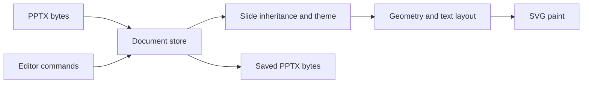

One document store holds the presentation. The browser editor, adapters, and automation hosts apply edits through that store.

## Follow a presentation

The engine reads PPTX bytes into an Open Packaging Conventions (OPC) package. It resolves slide inheritance before laying out shapes and text:

Parsing, inheritance resolution, and layout do not depend on the DOM. Browser painting consumes layout records rather than calculating a separate layout.

## Choose the right layer

Use editor commands for interactive features. Use the [Editing API](/docs/editor-api) for batch automation on a server or live editor.

Use lower-level store APIs only when you need package-level integration. Write document changes through `PptxDocumentStore` operations. Editing the rendered DOM does not change the presentation.

React and Vue read snapshots and dispatch commands. They do not keep a separate editable document model.

## Preserve document content

The package model retains content that the editor does not interpret. Rendering and editing support are distinct from preservation during save.

Consult [PPTX fidelity](/docs/pptx-fidelity) for feature-level evidence and rendering limits. Do not infer edit support from visible content alone.

## Use consistent fonts

Text layout uses font metrics. Configure fonts before comparing browser output with PDF output. Missing or substituted fonts can change line breaks and shape text.

For host font loading, see [Fonts](/docs/customization/fonts). For server output, see [PDF export](/docs/export/pdf).

## See also

- [Core](/docs/core)
- [Editing API](/docs/editor-api)
- [PPTX fidelity](/docs/pptx-fidelity)
