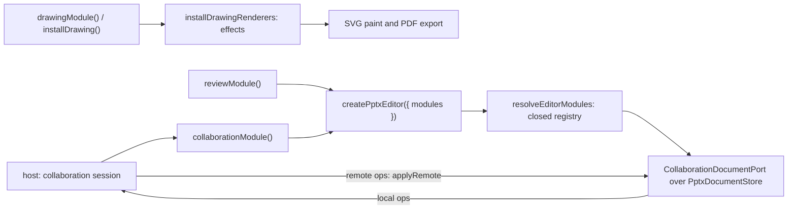

<p align="center">
  <a href="https://pptx-editor.dev/">
    <picture>
      <source media="(prefers-color-scheme: dark)" srcset="https://raw.githubusercontent.com/eigenpal/pptx-editor/main/.github/assets/readme-logo-dark.svg" />
      <source media="(prefers-color-scheme: light)" srcset="https://raw.githubusercontent.com/eigenpal/pptx-editor/main/.github/assets/readme-logo-light.svg" />
      
    </picture>
  </a>
</p>

<p align="center">
  <a href="https://www.npmjs.com/package/@pptx-editor.dev/pro"></a>
  <a href="https://www.npmjs.com/package/@pptx-editor.dev/pro"></a>
  <a href="https://github.com/eigenpal/pptx-editor/blob/main/packages/pro/LICENSE.md"></a>
</p>

# @pptx-editor.dev/pro

Commercial capabilities for PPTX Editor, delivered as `EditorModule`s, in the same shape as DOCX Editor's `@docx-editor.dev/pro`:

- `reviewModule()`: the review queue. It reads legacy comments (`p:cmLst`, ECMA-376 Part 1, 19.4) and their replies today.
- `collaborationModule({ session })`: attaches a host-created collaboration session to each opened deck.
- `createYjsCollaborationSession({ doc, documentId, identity, awareness })`: a session over a Y.Doc. It mirrors the deck into Yjs, as DOCX Editor does, so concurrent edits merge without a server sequencer.
  - **History:** while the session is attached, the editor's undo and redo revert only your own changes (`Y.UndoManager`), never a peer's, and return to the slide and selection of the undone change.
  - **Status:** `statusSnapshot()` and `subscribeStatus()` report the state and a typed `CollaborationFailureCode`, as in DOCX Editor. Call `setConnected()` from your provider's status event.
  - **Concurrent edits:** two peers that add or replace an element that a slide, shape, or paragraph holds once end with one element, and the other peer's copy stays hidden in the room until the winner undoes. Property elements merge. Concurrent splits of one run keep its text once, and a node moved into content that a peer removes at once goes back. The `collaboration.realtime` row in `docs/site/data/pptx-features.ts` states what is supported and its limits. A room from a pre-release build (room format 1) refuses to attach.
  - **Presence:** with a Yjs `awareness` (`y-protocols/awareness`), the editor publishes its selection, and the canvas shows each peer's selected shapes and text caret, with the peer's name and color. Your caret stays on its character while peers type before it.
- `drawingModule()` from `@pptx-editor.dev/pro/drawing`: paints the shape and picture effects glow, inner shadow, reflection, and soft edge (ECMA-376 Part 1, 20.1.8). The free engine paints outer shadows. Without the module, a shape or picture paints without these four effects, and the editor chrome does not offer them: Shape Effects shows only the outer shadows, and Picture Styles shows only the frame styles. Removing an effect needs no module: when the selection has a reflection, glow, or soft edge, Shape Effects offers its No row, and No shadow also removes an inner shadow. The effect commands still write every effect, and save keeps it. PDF export (`@pptx-editor.dev/pptx-to-pdf`) always includes the module. It also draws charts from the values cached in their chart parts (ECMA-376 Part 1, 21.2); see [Charts](#charts).

This package uses the EigenPal Pro License (`LICENSE.md`). Evaluation is permitted. Production use requires a commercial agreement.

For task guides and API details, see the [developer documentation](https://pptx-editor.dev/docs/pro).

## Use

```ts
import { createPptxEditor } from '@pptx-editor.dev/core';
import { collaborationModule, reviewModule } from '@pptx-editor.dev/pro';

const editor = createPptxEditor({
  document: bytes,
  modules: [reviewModule(), collaborationModule({ session })],
});
```

### Drawing effects

```ts
import { createPptxEditor } from '@pptx-editor.dev/core';
import { drawingModule } from '@pptx-editor.dev/pro/drawing';

const editor = createPptxEditor({
  document: bytes,
  modules: [drawingModule({ licenseKey: import.meta.env.VITE_PPTX_LICENSE })],
});
```

The drawing renderers serve every editor and export in the process. Create the module before the first document opens; a later install logs a console warning once, and slides painted before it keep their paint until they paint again. The chrome controls refresh after an install: in React and Vue, menus and `useEditorValueCommand` options then offer the effects. For headless rendering without an editor, call `installDrawing()` from the same entry.

In the React or Vue adapter, pass the same list in the `modules` prop of `PptxEditor` or its root. The editor reads it once, when it is created. Keep the list stable, for example in `useMemo` or a `const` in `setup`:

```tsx
<PptxEditor document={bytes} modules={modules} />
```

To collaborate over Yjs, create one session per editor from a Y.Doc and an awareness that your provider connects. This example links two editors in one page; in an app, each editor runs in its own browser with a provider such as Hocuspocus.

```ts
import * as Y from 'yjs';
import { Awareness, applyAwarenessUpdate, encodeAwarenessUpdate } from 'y-protocols/awareness';
import { createPptxEditor } from '@pptx-editor.dev/core';
import { collaborationModule, createYjsCollaborationSession } from '@pptx-editor.dev/pro';

// The deck to open, for example from a file input.
const bytes = new Uint8Array(await file.arrayBuffer());

function openReplica(doc: Y.Doc, awareness: Awareness, actorId: string, name: string) {
  const session = createYjsCollaborationSession({
    doc,
    awareness,
    documentId: 'quarterly-review',
    identity: { actorId, name, color: '#2563eb' },
  });
  const editor = createPptxEditor({ document: bytes, modules: [collaborationModule({ session })] });
  return { editor, session };
}

const docA = new Y.Doc();
const docB = new Y.Doc();
const awarenessA = new Awareness(docA);
const awarenessB = new Awareness(docB);
// A provider does this over the network. Here, two docs in one page.
docA.on('update', (update, origin) => origin !== 'peer' && Y.applyUpdate(docB, update, 'peer'));
docB.on('update', (update, origin) => origin !== 'peer' && Y.applyUpdate(docA, update, 'peer'));
for (const [from, to] of [
  [awarenessA, awarenessB],
  [awarenessB, awarenessA],
] as const)
  from.on('update', ({ added, updated, removed }, origin) => {
    if (origin === 'peer') return;
    const changed = [...added, ...updated, ...removed];
    applyAwarenessUpdate(to, encodeAwarenessUpdate(from, changed), 'peer');
  });

const a = openReplica(docA, awarenessA, 'user-1', 'Ada');
const b = openReplica(docB, awarenessB, 'user-2', 'Grace');
a.editor.attach(document.getElementById('editor-a')!);
b.editor.attach(document.getElementById('editor-b')!);

// When a person leaves: destroy the editor, then the session. Peers stop showing them.
a.editor.destroy();
a.session.destroy();
```

The first replica in an empty room seeds it from its deck. Later replicas adopt the room.

Your host must authenticate participants and authorize access to each document before connecting its provider. A `documentId` identifies a document; it does not grant access. Enforce read and write permissions in your provider or server, including update and awareness messages. Disconnect participants when their access ends. Use an encrypted connection for network transport.

Registering a module is the whole enablement story. Without modules, the free engine works the same: decks round-trip, comments and effects are kept, and no replica attaches.

## Charts

`@pptx-editor.dev/pro/drawing` draws bar and column charts (clustered, stacked, and percent stacked), line, area, scatter, pie, doughnut, and radar charts, with titles, legends, axes, gridlines, data labels, and number formats. 3-D, of-pie, stock, bubble, and surface charts, and charts with trendlines or error bars, keep the placeholder. A chart is not editable, and its part saves unchanged.

```ts
import { createPptxEditor } from '@pptx-editor.dev/core/editor';
import { drawingModule } from '@pptx-editor.dev/pro/drawing';

const editor = createPptxEditor({ document: bytes, modules: [drawingModule({ licenseKey })] });
```

For headless layout, call `installDrawing({ licenseKey })` once. The renderers serve every editor and export in the process, so install them before the first deck opens. `@pptx-editor.dev/pptx-to-pdf` always installs them.

A chart becomes shapes and labels that the engine lays out like any other shape, with the same text measurer. The editor and the PDF export draw that one layout.

## How it connects to the engine



The module seam is in `packages/core/src/editor/modules.ts`. It is closed, as in DOCX Editor: every contribution point is named there, and core never imports this package. The drawing seam is in `packages/core/src/layout/drawing-renderers.ts`, after DOCX Editor's: the effects renderer returns SVG as plain data, and the engine's paint builds it.

## Tracked changes in PPTX

PresentationML has no tracked-change markup: there is no equivalent of WordprocessingML `w:ins` and `w:del`. Review in a PPTX file is comments only. So a PPTX Editor suggestion cannot live in the deck the way a `w:ins` or `w:del` revision lives in a DOCX file.

## License

The EigenPal Pro License permits evaluation. Production use requires a commercial agreement. The package makes no network requests for licensing.

## Room access

Your host must authenticate participants and authorize document access before connecting the provider. A `documentId` identifies a document; it does not grant access. Enforce read and write permissions in your provider or server, including update and awareness messages. Disconnect participants when their access ends. Use an encrypted connection for network transport.
